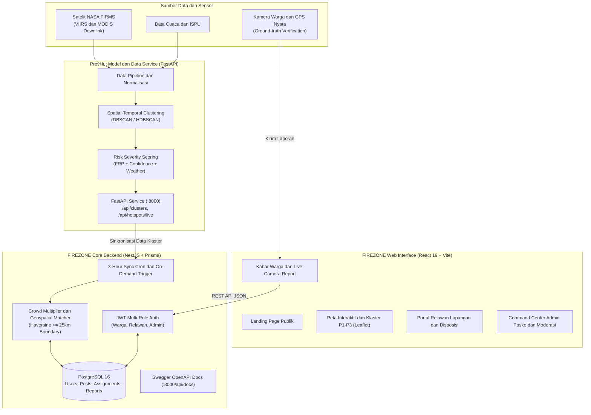

# FIREZONE — Early Hazard Intelligence & Civic Transparency

[](https://react.dev/)
[](https://nestjs.com/)
[](https://www.typescriptlang.org/)
[](https://www.postgresql.org/)
[](https://www.prisma.io/)
[](https://tailwindcss.com/)
[](https://leafletjs.com/)
[](https://www.docker.com/)
[](https://prevhutweb-production.up.railway.app/api/docs)
[](https://prevhut-production.up.railway.app/docs)

> **Platform Terpadu Peringatan Dini Kebakaran Hutan dan Lahan (Karhutla), Disposisi Relawan Lapangan, serta Transparansi Publik Berbasis AI dan Verifikasi Komunitas.**

---

## Tautan Deployment Production & Dokumentasi API Live

| Layanan | Deskripsi | URL Production (Railway) |
| :--- | :--- | :--- |
| **Frontend Web App** | Antarmuka utama aplikasi web **FIREZONE** | [https://firezone-production.up.railway.app](https://firezone-production.up.railway.app) |
| **Core Backend API Docs** | Dokumentasi interaktif Swagger OpenAPI (NestJS) | [https://prevhutweb-production.up.railway.app/api/docs](https://prevhutweb-production.up.railway.app/api/docs) |
| **Data & AI Microservice Docs** | Dokumentasi interaktif Swagger UI (FastAPI PrevHut) | [https://prevhut-production.up.railway.app/docs](https://prevhut-production.up.railway.app/docs) |
| **Data & AI Microservice ReDoc** | Dokumentasi alternatif ReDoc (FastAPI PrevHut) | [https://prevhut-production.up.railway.app/redoc](https://prevhut-production.up.railway.app/redoc) |

---

## Repositori Model AI dan Pemrosesan Data (PrevHut)

Model *Machine Learning*, kalkulasi skor risiko, dan *pipeline* pengolahan data satelit untuk platform FIREZONE dikembangkan secara terpisah pada repositori berikut:

* **GitHub Model Repo:** [**https://github.com/onyourjie/prevhut**](https://github.com/onyourjie/prevhut)
* **Live FastAPI Swagger Docs:** [**https://prevhut-production.up.railway.app/docs**](https://prevhut-production.up.railway.app/docs)

### Peran Repositori Model (prevhut):
* **Pembersihan dan Ingesti Data Satelit:** Mengambil data telemetri satelit NASA FIRMS (VIIRS dan MODIS) untuk memantau titik panas (*hotspot*) secara *near real-time*.
* **Spatial dan Temporal Clustering (DBSCAN/HDBSCAN):** Mengelompokkan sebaran ribuan titik api menjadi klaster area pantau bahaya terpadu (*bounding box* dan koordinat *centroid*).
* **Fire Hazard Risk Scoring:** Menghitung indeks probabilitas dan tingkat keparahan kebakaran berdasarkan parameter FRP (*Fire Radiative Power*), tingkat kepercayaan deteksi, tutupan lahan, cuaca, dan ISPU (*Indeks Standar Pencemar Udara*).
* **Fairness Crowd Urgency Multiplier:** Algoritma *diminishing returns* untuk mengintegrasikan laporan langsung warga ke dalam eskalasi prioritas klaster bahaya (P1, P2, P3).
* **FastAPI Microservice (http://localhost:8000):** Menyediakan REST API data geospasial klaster yang dikonsumsi oleh Backend NestJS platform ini.

---

## Tentang FIREZONE

Kebakaran Hutan dan Lahan (Karhutla) di Indonesia, khususnya wilayah rawan seperti Kalimantan Barat, membutuhkan respon penanganan yang cepat, presisi, dan terkoordinasi. Keterbatasan pantauan satelit akibat tutupan awan atau latensi orbit sering kali menimbulkan jeda informasi, sedangkan laporan warga sering kali terkendala validitas data (isu hoaks atau ketidaksesuaian titik lokasi).

**FIREZONE** hadir sebagai jembatan dua arah (*Dual-Confirmed Early Warning*):
1. **Top-Down:** Pemantauan satelit NASA FIRMS yang diolah dengan *machine learning* untuk mendeteksi klaster potensi api (P1: Kritis/Tinggi, P2: Waspada/Sedang, P3: Pantauan/Rendah).
2. **Bottom-Up:** Verifikasi *ground-truth* dari warga lokal melalui pelaporan kamera langsung (*live WebRTC camera*) dengan *watermark* GPS dan waktu presisi guna menangkal laporan palsu.
3. **Aksi Lapangan:** Disposisi tugas dari Admin Posko BPBD langsung ke gawai Relawan Lapangan terdekat, lengkap dengan pelacakan status penanganan hingga bukti verifikasi pemadaman tuntas.

---

## Arsitektur Sistem



---

## Fitur-Fitur Utama

### 1. Peta Interaktif dan Manajemen Klaster Risiko Bahaya (Leaflet)
* Visualisasi poligon klaster bahaya dengan diferensiasi tingkat prioritas:
  * **P1 (Prioritas Tinggi):** Klaster aktif dengan intensitas FRP tinggi atau telah dikonfirmasi oleh laporan warga sekitar.
  * **P2 (Prioritas Sedang):** Klaster dalam pemantauan waspada.
  * **P3 (Prioritas Rendah):** Titik panas sporadis dengan risiko penyebaran minim.
* Filter geospasial berdasarkan provinsi, kabupaten, kecamatan, serta tanggal kejadian.
* Lapisan informasi cuaca *real-time*, arah angin, dan Indeks Standar Pencemar Udara (ISPU).

### 2. Pelaporan Warga Anti-Hoaks (Civic Reporting)
* **WebRTC Live Camera Only:** Laporan darurat diwajibkan mengambil foto langsung melalui kamera gawai (mencegah unggahan gambar dari galeri yang rawan manipulasi).
* **Watermark Koordinat dan Waktu Nyata:** Pencatatan latitude, longitude, dan stempel waktu (*timestamp*) secara otomatis saat gambar diambil.
* **Update Pengirim dan Komentar Terbuka:** Pelapor dan warga dapat memberikan pembaruan kondisi langsung dari lokasi kejadian (*threads* pemantauan).

### 3. Fairness Crowd Urgency Multiplier
Sistem penggabungan antara skor satelit dan konfirmasi warga menggunakan prinsip *diminishing returns*:
* **0 Laporan:** +0.0 poin (mengandalkan skor murni satelit).
* **1 Laporan Warga:** +5.0 poin (*Dual-Confirmed Ground Truth*).
* **2–3 Laporan Warga:** +10.0 poin (Konsensus warga sekitar).
* **>= 4 Laporan Warga:** Maksimal +15.0 poin (Eskalasi darurat publik).

### 4. Sistem Disposisi Relawan Lapangan (Field Operations)
* **Direktori Relawan:** Admin Posko dapat melihat relawan yang berstatus *Available* (Siap Bertugas) terdekat dari titik insiden.
* **Alur Penanganan Transparan:**
  `ASSIGNED` → `ACCEPTED` → `ON_THE_WAY` → `ON_SITE` → `COMPLETED`
* **Verifikasi Tuntas:** Relawan wajib mengunggah foto bukti pemadaman beserta koordinat GPS lokasi sebelum tugas dapat ditandai sebagai `COMPLETED`.
* **Hak Menolak Disertai Alasan:** Relawan dapat menolak tugas jika berada di luar jangkauan atau terdapat kendala logistik.

### 5. Moderasi Konten dan Verifikasi Hoaks Posko
* Warga dapat melaporkan postingan yang mencurigakan dengan alasan: `HOAX_INFO_PALSU`, `FOTO_LOKASI_TIDAK_SESUAI`, `SPAM`, atau `LAINNYA`.
* Admin Posko memiliki wewenang:
  * **Tolak Hoaks:** Menandai konten palsu dan **otomatis mereset skor urgensi warga menjadi 0** agar klaster satelit kembali akurat.
  * **Setujui Valid:** Mengonfirmasi laporan sah.
  * **Hapus Postingan:** Menghapus laporan bermasalah secara permanen dari basis data.

### 6. Manajemen Insiden Posko (Incident Grouping)
* Pengelompokan cerdas beberapa laporan warga di wilayah atau desa yang berdekatan ke dalam satu kelompok insiden (*Incident Cluster*).
* Penugasan tim relawan ke insiden utama otomatis memperbarui status penanganan seluruh laporan warga yang tergabung di dalamnya.

### 7. Otomatisasi Sinkronisasi Satelit (Setiap 3 Jam)
* **Cron Job Otomatis:** Berjalan di latar belakang pada pukul **01.00, 04.00, 07.00, 10.00, 13.00, 16.00, 19.00, 22.00 WIB**, diselaraskan dengan waktu rilis data downlink satelit VIIRS NASA FIRMS.
* **On-Demand Manual Trigger:** Tombol pembaruan langsung bagi Admin Posko untuk menarik data satelit terbaru kapan saja.

### 8. Siaga Darurat 24 Jam dan Protokol Evakuasi Cepat
* Tombol cepat hubungi saluran darurat terpadu: **Damkar (113)**, **Tim SAR (115)**, **Kepolisian (110)**, dan **Ambulans (119)**.
* Panduan 5 langkah evakuasi tanggap darurat Karhutla.

---

## Matriks Hak Akses Peran (Role-Based Access Control)

| Modul dan Kemampuan Fitur | Tamu (Belum Login) | Warga | Relawan | Admin Posko BPBD |
| :--- | :---: | :---: | :---: | :---: |
| Akses Landing Page Publik | Ya | Ya | Ya | Ya |
| Peta Sebaran Klaster dan Titik Api (`/map`) | Ya (Nav Atas) | Ya (Sidebar) | Ya (Sidebar) | Ya (Sidebar) |
| Melihat Kabar dan Laporan Warga (`/community`) | Ya | Ya | Ya | Ya |
| Buat Laporan Api Kamera Live (`/community/create`) | Perlu Login | Ya | Ya | Ya |
| Beri Komentar dan Laporkan Hoaks | Perlu Login | Ya | Ya | Ya |
| Toggle Status Siap Siaga (*Available*) | Tidak | Tidak | Ya | Ya |
| Terima/Tolak dan Update Status Tugas (`/assignments`) | Tidak | Tidak | Ya | Ya |
| Upload Bukti Foto dan GPS Penyelesaian Tugas | Tidak | Tidak | Ya | Ya |
| Disposisi Tugas ke Relawan Lapangan | Tidak | Tidak | Tidak | Ya |
| Panel Moderasi Aduan Hoaks (`/moderation`) | Tidak | Tidak | Tidak | Ya |
| Manajemen Insiden Posko dan Unduh Data (`/reports`) | Tidak | Tidak | Tidak | Ya |
| Trigger Manual Sinkronisasi Satelit (`/sync`) | Tidak | Tidak | Tidak | Ya |

---

## Akun Demo Uji Coba (Pre-Seeded Credentials)

Database telah dilengkapi dengan data *seed* awal untuk memudahkan pengujian seluruh peran:

| Peran | Nama Pengguna | Alamat Email | Kata Sandi | Kegunaan Pengujian |
| :--- | :--- | :--- | :--- | :--- |
| **Admin Posko** | Koordinator Posko BPBD | `admin.posko@fireline.id` | `Admin123!` | Pengujian disposisi tugas, verifikasi aduan hoaks, manajemen insiden terpadu, dan sinkronisasi satelit |
| **Relawan Lapangan** | Rangga Wicaksono | `rangga.relawan@gmail.com` | `Rangga123!` | Pengujian alur tugas lapangan (Terima/Tolak, On The Way, On Site, Upload Bukti GPS dan Foto Tuntas) |
| **Warga (Pelapor)** | Sarah Wijiyatno | `sarahwijiyatno@gmail.com` | `Sarah123!` | Pengujian buat laporan kamera langsung, lihat riwayat aktivitas, edit profil, dan aduan hoaks |
| **Warga (Korban)** | Rina | `rina.warga@gmail.com` | `Rina123!` | Pelapor kebakaran darurat di Desa Bancoh |

> **Kebijakan Kata Sandi (Password Policy):**  
> Minimal 8 karakter, wajib mengandung minimal 1 huruf besar (`A-Z`), 1 huruf kecil (`a-z`), 1 angka (`0-9`), dan 1 simbol khusus (`!@#$%^&*()_+-=[]{};':"|,.<>/?`).

---

## Panduan Instalasi dan Menjalankan Aplikasi

### Prasyarat Sistem:
* [Node.js](https://nodejs.org/) v20+ atau v22+
* [Docker dan Docker Compose](https://www.docker.com/)
* [Git](https://git-scm.com/)
* [Python 3.10+](https://www.python.org/) *(jika ingin menjalankan microservice model PrevHut secara lokal)*

---

### Opsi 1: Menjalankan Cepat dengan Docker (Database dan Backend)

1. **Clone repositori ini:**
   ```bash
   git clone https://github.com/onyourjie/prevhut_web.git fireline_web
   cd fireline_web
   ```

2. **Jalankan container dengan Docker Compose:**
   ```bash
   docker compose up -d
   ```
   Langkah ini akan otomatis mengaktifkan:
   * **`fireline_postgres`** (PostgreSQL 16) pada port `5432`
   * **`fireline_backend`** (NestJS Core API) pada port `3000`

3. **Jalankan Frontend secara lokal:**
   ```bash
   cd frontend
   npm install
   npm run dev
   ```
   Aplikasi web siap dibuka di: **`http://localhost:5173`**

---

### Opsi 2: Menjalankan Secara Manual (Development Mode)

#### Langkah 1: Jalankan Database PostgreSQL
Gunakan Docker untuk menjalankan PostgreSQL saja:
```bash
docker compose up -d postgres
```

#### Langkah 2: Setup dan Jalankan Core Backend (NestJS)
1. Masuk ke direktori backend:
   ```bash
   cd backend
   ```
2. Buat file `.env` (salin dari `.env.example`):
   ```bash
   cp .env.example .env
   ```
3. Install dependensi:
   ```bash
   npm install
   ```
4. Lakukan sinkronisasi schema dan pengisian data demo:
   ```bash
   npx prisma db push
   npx tsx prisma/seed.ts
   ```
5. Jalankan server backend dalam mode *watch*:
   ```bash
   npm run start:dev
   ```
   * Backend berjalan di: **`http://localhost:3000`**
   * Dokumentasi interaktif Swagger UI: **`http://localhost:3000/api/docs`**

#### Langkah 3: Setup dan Jalankan Frontend Web (React 19)
1. Buka terminal baru dan masuk ke folder frontend:
   ```bash
   cd frontend
   ```
2. Buat file `.env` (salin dari `.env.example`):
   ```bash
   cp .env.example .env
   ```
   Pastikan konfigurasi mengarah ke backend:
   ```env
   VITE_API_URL=http://localhost:3000
   VITE_DATA_SERVICE_URL=http://localhost:8000
   ```
3. Install dependensi:
   ```bash
   npm install
   ```
4. Jalankan Vite dev server:
   ```bash
   npm run dev
   ```
   Frontend aktif di: **`http://localhost:5173`**

---

### Menjalankan Microservice Model AI (prevhut)

Agar fitur kalkulasi klaster dan *live hotspots* satelit bekerja penuh secara lokal:

1. Clone repositori model di luar folder web:
   ```bash
   git clone https://github.com/onyourjie/prevhut.git
   cd prevhut
   ```
2. Buat *virtual environment* Python dan install dependensi:
   ```bash
   python -m venv venv
   source venv/bin/activate  # Di Windows: venv\Scripts\activate
   pip install -r requirements.txt
   ```
3. Jalankan FastAPI service:
   ```bash
   uvicorn main:app --host 0.0.0.0 --port 8000 --reload
   ```
   Data service akan menyala di **`http://localhost:8000`** dan siap dihubungkan dengan Core Backend FIREZONE.

---

## Struktur Direktori Repositori

```text
fireline_web/
├── docker-compose.yml          # Konfigurasi container PostgreSQL dan NestJS Backend
├── README.md                   # Dokumentasi utama proyek
│
├── backend/                    # Core Backend (NestJS 12 + Prisma ORM)
│   ├── Dockerfile              # Docker build file untuk backend
│   ├── package.json
│   ├── prisma/
│   │   ├── schema.prisma       # Definisi skema database PostgreSQL
│   │   ├── seed.ts             # Script seed data awal dan akun demo terverifikasi
│   │   └── relawan_seed.ts     # Script seed data direktori relawan
│   ├── src/
│   │   ├── main.ts             # Entry point dan inisialisasi Swagger UI
│   │   ├── app.module.ts
│   │   ├── auth/               # Modul registrasi, login JWT, dan role guard
│   │   ├── users/              # Modul manajemen profil, GPS, dan daftar relawan
│   │   ├── community/          # Pelaporan warga, live feed, komentar, dan aduan hoaks
│   │   ├── assignments/        # Modul penugasan, pelacakan lapangan, dan verifikasi tugas
│   │   ├── hotspots/           # Integrasi service klaster dan live hotspots satelit
│   │   ├── scheduler/          # Cron job otomatisasi pembaruan satelit setiap 3 jam
│   │   ├── emergency/          # Nomor kontak darurat dan protokol evakuasi
│   │   ├── notifications/      # Pusat notifikasi peringatan dini
│   │   └── prisma/             # Service koneksi Prisma Client
│   └── test/                   # Unit dan e2e testing (Vitest)
│
└── frontend/                   # Web Application (React 19 + Vite 8 + Tailwind CSS v4)
    ├── package.json
    ├── vite.config.ts
    ├── index.html
    ├── public/
    └── src/
        ├── routes/             # File-based routing (@tanstack/react-router)
        │   ├── __root.tsx      # Root provider dan shell layout
        │   ├── index.tsx       # Landing page (tamu) / Beranda dasbor (login)
        │   ├── map.tsx         # Peta interaktif Leaflet sebaran klaster bahaya
        │   ├── community/      # Forum warga dan form lapor api kamera live
        │   ├── assignments.tsx # Panel disposisi dan tugas relawan lapangan
        │   ├── moderation.tsx  # Panel moderasi aduan hoaks Admin Posko
        │   ├── reports.tsx     # Manajemen insiden dan transparansi data terbuka
        │   ├── emergency.tsx   # Layar siaga darurat dan panduan evakuasi
        │   ├── profile.tsx     # Profil pengguna dan riwayat aktivitas
        │   └── faq.tsx         # Pusat bantuan dan metodologi
        ├── components/         # Komponen UI modular
        │   ├── layout/         # TopNavbar, AppSidebar, BottomNav
        │   ├── features/       # HotspotMap, MapSidebar, AreaDetailPanel
        │   ├── community/      # PostCard, LiveCameraViewfinder, FlagModal
        │   ├── assignments/    # AssignmentCard, CreateAssignmentModal, VerifyTaskModal
        │   └── landing/        # Komponen seksi landing page publik
        ├── lib/                # Konfigurasi API client, utilitas, dan store Zustand
        └── types/              # Deklarasi TypeScript type dan interface
```

---

## Dokumentasi dan Rangkuman Endpoint API (Swagger OpenAPI)

Platform ini memiliki dua layanan API terdokumentasi penuh dengan standar OpenAPI / Swagger UI:

1. **Core Backend API (NestJS):**
   * **Production Swagger UI:** [**https://prevhutweb-production.up.railway.app/api/docs**](https://prevhutweb-production.up.railway.app/api/docs)
   * **Local Development:** `http://localhost:3000/api/docs`
2. **Data & Intelligence Microservice API (FastAPI):**
   * **Production Swagger UI:** [**https://prevhut-production.up.railway.app/docs**](https://prevhut-production.up.railway.app/docs)
   * **Production ReDoc:** [**https://prevhut-production.up.railway.app/redoc**](https://prevhut-production.up.railway.app/redoc)
   * **Local Development:** `http://localhost:8000/docs`

### A. Endpoint Core Backend (NestJS)

#### 1. Autentikasi (/auth)
* `POST /auth/register` — Pendaftaran akun multi-peran dengan validasi kata sandi kuat.
* `POST /auth/login` — Autentikasi pengguna dan pembuatan token akses JWT.
* `GET /auth/me` — Memeriksa profil dan sesi akun yang sedang aktif.

#### 2. Komunitas dan Laporan Warga (/community)
* `GET /community/posts` — Mengambil feed laporan titik api warga (filter: kategori, status, wilayah).
* `GET /community/posts/:id` — Detail laporan lengkap beserta kabar terbaru pengirim dan komentar.
* `POST /community/posts` — Membuat laporan darurat baru (simulasi kamera langsung dan koordinat GPS).
* `POST /community/posts/:id/updates` — Menambahkan pembaruan perkembangan penanganan di lokasi.
* `POST /community/posts/:id/comments` — Mengirim komentar / respon interaktif warga dan relawan.
* `POST /community/posts/:id/flag` — Melaporkan postingan yang terindikasi hoaks atau salah lokasi.
* `POST /community/posts/:id/moderate` — *(Admin Only)* Aksi moderasi: tolak hoaks, setujui, atau hapus.
* `GET /community/incidents` — Mengelompokkan laporan warga ke dalam klaster insiden posko.

#### 3. Penugasan Relawan Lapangan (/assignments)
* `POST /assignments` — *(Admin Only)* Menerbitkan penugasan baru kepada relawan untuk klaster tertentu.
* `GET /assignments` — *(Admin Only)* Memonitor seluruh penugasan relawan lapangan.
* `GET /assignments/my-tasks` — *(Relawan)* Melihat daftar penugasan pribadi.
* `PATCH /assignments/:id/status` — *(Relawan)* Memperbarui status: `ACCEPTED` → `ON_THE_WAY` → `ON_SITE` → `COMPLETED`.
* `POST /assignments/:id/reject` — *(Relawan)* Menolak penugasan disertai alasan logistik/jarak.
* `POST /assignments/:id/verify` — *(Relawan)* Mengunggah bukti foto dan GPS verifikasi tuntas.

#### 4. Klaster Satelit dan Hotspot (/hotspots)
* `GET /hotspots/clusters` — Mengambil daftar klaster area pantau yang telah diperkaya skor verifikasi warga.
* `GET /hotspots/clusters/:id` — Detail spesifik klaster, *bounding box*, dan daftar titik panas.
* `GET /hotspots/statistics` — Rekapitulasi jumlah klaster P1, P2, P3, dan total titik api aktif 24 jam.
* `GET /hotspots/live` — Mengambil titik panas mentah satelit NASA FIRMS terkini.
* `GET /hotspots/weather-ispu` — Kondisi cuaca dan ISPU real-time per kota di Kalimantan.
* `GET /hotspots/transparency/summary` — Ringkasan metrik akuntabilitas penanganan publik.
* `GET /hotspots/transparency/download-csv` — Unduh data terbuka daftar Area Pantau dalam format CSV.

#### 5. Otomasi dan Sinkronisasi (/sync)
* `GET /sync/status` — Status eksekusi cron sinkronisasi satelit (interval 3 jam).
* `POST /sync/trigger` — *(Admin Only)* Memicu proses sinkronisasi satelit secara langsung (*on-demand*).

### B. Endpoint Data & AI Microservice (FastAPI PrevHut)

* `GET /api/clusters` — Klaster hasil pengelompokan spasial DBSCAN (Haversine 8 km) dan Explainable Multi-Criteria Risk Score.
* `GET /api/clusters/statistics` — Statistik agregat klaster P1, P2, P3 dan total titik panas terklaster.
* `GET /api/clusters/{cluster_id}` — Detail lengkap satu Area Pantau beserta 30 titik panas FRP tertinggi di dalamnya.
* `GET /api/hotspots/live` (`/api/hotspots/24h`) — Data titik panas satelit NASA FIRMS VIIRS 375m 24 jam terakhir.
* `GET /api/hotspots/7d` — Riwayat titik panas satelit 7 hari terakhir untuk analisis persistensi.
* `GET /api/hotspots/stats` — Distribusi titik panas dan total energi radiasi termal (FRP) per provinsi di Kalimantan.
* `GET /api/weather-ispu` & `GET /api/weather-ispu/{city}` — Observasi meteorologi atmosfer langsung dari Open-Meteo (suhu, kelembapan, arah angin, dan kondisi cuaca).
* `GET /api/transparency/summary` — Metrik KPI transparansi publik.
* `GET /api/transparency/download-csv` — Ekspor dataset Area Pantau prioritas Kalimantan ke CSV.
* `POST /api/sync` — Sinkronisasi langsung ke API NASA FIRMS dan kalkulasi ulang DBSCAN clustering.

---

## Lisensi dan Kontributor

Dikembangkan sebagai bagian dari inisiatif penanggulangan bencana Karhutla dan transparansi data publik (WIA MIA 2026).

* **Model dan Data Science:** [onyourjie/prevhut](https://github.com/onyourjie/prevhut)
* **Web dan Microservices Platform:** [onyourjie/prevhut_web](https://github.com/onyourjie/prevhut_web)
