# FIREZONE Frontend (React 19 + TypeScript + TanStack Router & Query + Tailwind CSS v4)

Frontend web interaktif untuk platform **FIREZONE — Kalimantan Early Hazard** (WIA MIA 2026). Mengimplementasikan sistem peringatan dini kebakaran hutan dan lahan (Karhutla) berbasis klaster satelit NASA FIRMS, pelaporan warga *real-time* dengan kamera langsung & verifikasi GPS, manajemen disposisi relawan lapangan, serta pusat komando Admin Posko BPBD.

---

## Tech Stack Utama

* **Framework & Build Tool:** React 19 + TypeScript + Vite 8
* **Routing:** `@tanstack/react-router` (File-based routing dengan proteksi peran/role)
* **Data Fetching & Caching:** `@tanstack/react-query`
* **State Management:** `zustand` (dengan persistensi sesi autentikasi di `localStorage`)
* **Styling & Animasi:** Tailwind CSS v4, `motion` (Framer Motion), `gsap` (ScrollTrigger), `swiper`
* **Peta Interaktif & Geospasial:** `leaflet` & `react-leaflet` (Poligon klaster bahaya P1–P3, titik panas satelit, titik laporan warga, dan pemilih koordinat domisili)
* **Media & Utilitas:** Cloudinary Upload API, WebRTC Live Camera Viewfinder, SweetAlert2, Lucide Icons

---

## 💻 Cara Menjalankan Secara Lokal (Development)

### 1. Masuk ke direktori frontend & install dependensi:
```bash
cd frontend
npm install
```

### 2. Konfigurasi Environment (`.env`):
Pastikan file `.env` di dalam folder `frontend/` mengarah ke URL Backend dan Data Service:
```env
VITE_API_URL=http://localhost:3000
VITE_DATA_SERVICE_URL=http://localhost:8000
```

### 3. Jalankan Dev Server:
```bash
npm run dev
```
Aplikasi akan berjalan di: **`http://localhost:5173`**

### 4. Build untuk Production:
```bash
npm run build
```

---

## 🗺️ 1. Diagram Hierarki Halaman (Full Sitemap)

Berikut adalah struktur hierarki seluruh halaman aplikasi **FIREZONE** sesuai route aktual di codebase:

```mermaid
flowchart TD
    Root["🏠 Beranda / Root<br/>( / )"]

    %% Cabang Kondisi Auth di Root
    Root --> GuestLanding["🌐 Landing Page Publik<br/>( / atau /landing )<br/>[Unauthenticated]"]
    Root --> AuthDash["📊 Dasbor Utama<br/>( / )<br/>[Authenticated: Warga / Relawan / Admin]"]

    %% Cabang Halaman Utama (Level 1)
    Root --> MapPage["📍 Peta Sebaran Api<br/>( /map )"]
    Root --> CommunityPage["📰 Kabar Warga / Komunitas<br/>( /community )"]
    Root --> EmergencyPage["🛡️ Siaga 24 Jam / Darurat<br/>( /emergency )"]
    Root --> FaqPage["📖 FAQ & Metodologi<br/>( /faq )"]
    Root --> AuthGroup["🔐 Autentikasi<br/>( /login & /register )"]
    Root --> ProfilePage["👤 Profil Pengguna<br/>( /profile )"]
    Root --> RolePages["⚡ Modul Operasional<br/>(Khusus Relawan & Admin)"]
    Root --> NotifModule["🔔 Pusat Notifikasi Terpadu<br/>( NotificationBell & FCM Web Push )"]

    %% Sub-cabang Peta
    MapPage --> MapFilter["Filter Wilayah & Waktu<br/>(MapFilterSheet / Sidebar)"]
    MapPage --> AreaDetail["Detail Klaster & Prioritas P1-P3<br/>(AreaDetailSheet / Panel)"]

    %% Sub-cabang Komunitas & Lapor Api
    CommunityPage --> CreatePost["🔥 Lapor Titik Api<br/>( /community/create )"]
    CommunityPage --> PostDetail["💬 Detail Laporan & Pelacakan Respon<br/>( /community/$postId )"]
    CreatePost --> LiveCam["📸 Kamera Langsung & GPS<br/>(LiveCameraViewfinder)"]
    CreatePost --> ConfirmModal["✅ Konfirmasi Publikasi<br/>(PublishConfirmationModal)"]

    %% Sub-cabang Autentikasi
    AuthGroup --> LoginPage["Masuk Akun<br/>( /login )"]
    AuthGroup --> RegisterPage["Daftar Akun Multi-Step (1-5)<br/>( /register )"]

    %% Sub-cabang Profil
    ProfilePage --> EditProfile["Edit Profil & Titik Koordinat<br/>(EditProfileModal)"]
    ProfilePage --> ActivityHist["Riwayat Laporan, Post & Komentar<br/>(ProfileActivitiesModal)"]

    %% Sub-cabang Operasional (Relawan & Admin)
    RolePages --> AssignmentsPage["🛡️ Penugasan Relawan<br/>( /assignments )<br/>[Relawan & Admin]"]
    RolePages --> ReportsPage["📋 Manajemen Laporan Posko<br/>( /reports )<br/>[Khusus Admin]"]
    RolePages --> ModerationPage["🚨 Moderasi Konten & Hoaks<br/>( /moderation )<br/>[Khusus Admin]"]

    AssignmentsPage --> CreateAssign["Disposisi Tugas Baru<br/>(CreateAssignmentModal)"]
    AssignmentsPage --> VerifyReject["Verifikasi / Tolak Tugas<br/>(VerifyTaskModal & RejectTaskModal)"]
```



### Struktur Tree Halaman & Sub-Alur:
```text
🏠 Beranda ( / )
 ├── 🌐 Landing Page Publik (Jika Belum Login / Guest)
 ├── 📊 Dasbor Utama (Jika Sudah Login: Warga / Relawan / Admin)
 │    ├── Modal Panduan Evakuasi (EvacuationGuideModal)
 │    └── Modal Panggilan Darurat Cepat (EmergencyCallModal)
 │
 ├── 📍 Peta Sebaran Api ( /map )
 │    ├── Sidebar / Sheet Daftar Area Prioritas (P1, P2, P3)
 │    ├── Panel Detail Area & Cuaca (AreaDetailPanel / Sheet)
 │    └── Filter Provinsi, Kabupaten, Kecamatan & Waktu (MapFilterSheet)
 │
 ├── 📰 Kabar Warga / Komunitas ( /community )
 │    ├── Filter Kategori & Wilayah (FilterModal)
 │    ├── 🔥 Lapor Titik Api ( /community/create )
 │    │    ├── Kamera Langsung & Geotagging GPS (LiveCameraViewfinder)
 │    │    ├── Form Kategori, Deskripsi & Lokasi (CreateLocationSection)
 │    │    └── Konfirmasi Laporan & Peringatan Darurat (PublishConfirmationModal)
 │    └── 💬 Detail Laporan Warga ( /community/$postId )
 │         ├── Pelacakan Status Penanganan (ResponseTrackingSection)
 │         ├── Update Progres Pengirim (PostUpdatesSection & UpdateModal)
 │         ├── Komentar & Diskusi Warga (PostCommentsSection)
 │         └── Laporkan Konten Palsu/Hoaks (FlagModal)
 │
 ├── 🛡️ Siaga 24 Jam / Panggilan Darurat ( /emergency )
 │    ├── Direktori Kontak Darurat (Damkar 113, SAR 115, Polisi 110, Ambulans 119)
 │    └── Protokol Evakuasi Keselamatan Karhutla
 │
 ├── 📖 FAQ & Metodologi Algoritma ( /faq )
 │
 ├── 🔐 Autentikasi
 │    ├── Masuk Akun ( /login )
 │    └── Daftar Akun 5 Tahap ( /register )
 │         ├── Step 1: Data Diri
 │         ├── Step 2: Kata Sandi & Keamanan
 │         ├── Step 3: Pilihan Peran (Warga / Relawan)
 │         ├── Step 4: Lokasi Domisili & Titik Koordinat Peta
 │         └── Step 5: Layar Sambutan (Welcome)
 │
 ├── 👤 Profil Pengguna ( /profile )
 │    ├── Edit Profil & Peta Domisili (EditProfileModal)
 │    ├── Riwayat Aktivitas: Postingan, Komentar, Laporan (ProfileActivitiesModal)
 │    └── Pengaturan Toggle GPS Selalu Aktif & Logout
 │
 ├── 🛡️ Penugasan Relawan ( /assignments ) — [Khusus Relawan & Admin]
 │    ├── Direktori Relawan Siaga (VolunteerDirectoryPanel)
 │    ├── Buat Disposisi Tugas Baru (CreateAssignmentModal - Admin)
 │    ├── Update Status Tugas (ACCEPTED -> ON_THE_WAY -> ON_SITE -> COMPLETED)
 │    ├── Verifikasi Bukti Lapangan (VerifyTaskModal)
 │    └── Tolak Penugasan dengan Alasan (RejectTaskModal)
 │
 ├── 📋 Manajemen Laporan Insiden ( /reports ) — [Khusus Admin Posko]
 │
 ├── 🚨 Moderasi Konten & Hoaks ( /moderation ) — [Khusus Admin Posko]
 │
 └── 🔔 Pusat Notifikasi (⚠️ BAGIAN YANG MASIH KURANG DI FE)
      ├── Riwayat Notifikasi "Hari Ini" & "Sebelumnya"
      ├── Tandai 1 Dibaca & Tandai Semua Dibaca
      └── Navigasi Cepat ke Peta Bahaya P1 / Tugas Baru Relawan
```

---

## 📋 2. Daftar Lengkap Route & Halaman

| No | Nama Halaman | Path Route | File Route (`src/routes/`) | Akses Role | Status |
| :-: | :--- | :--- | :--- | :--- | :--- |
| 1 | **Beranda / Root** | `/` | `index.tsx` | Semua (Unauth = Landing, Auth = Dasbor) | ✅ Selesai |
| 2 | **Landing Page** | `/landing` | `landing.tsx` | Publik / Guest | ✅ Selesai |
| 3 | **Peta Sebaran Api** | `/map` | `map.tsx` | Publik, Warga, Relawan, Admin | ✅ Selesai |
| 4 | **Kabar Warga (Feed)** | `/community` | `community/index.tsx` | Publik, Warga, Relawan, Admin | ✅ Selesai |
| 5 | **Detail Kabar Warga** | `/community/$postId` | `community/$postId.tsx` | Publik, Warga, Relawan, Admin | ✅ Selesai |
| 6 | **Lapor Titik Api** | `/community/create` | `community/create.tsx` | Warga, Relawan, Admin (Wajib Login) | ✅ Selesai |
| 7 | **Siaga 24 Jam (Darurat)** | `/emergency` | `emergency.tsx` | Publik, Warga, Relawan, Admin | ✅ Selesai |
| 8 | **FAQ & Metodologi** | `/faq` | `faq.tsx` | Publik, Warga, Relawan, Admin | ✅ Selesai |
| 9 | **Masuk (Login)** | `/login` | `login.tsx` | Publik / Guest | ✅ Selesai |
| 10 | **Daftar (Register)** | `/register` | `register.tsx` | Publik / Guest | ✅ Selesai |
| 11 | **Profil Pengguna** | `/profile` | `profile.tsx` | Warga, Relawan, Admin (+ Guest View) | ✅ Selesai |
| 12 | **Penugasan Relawan** | `/assignments` | `assignments.tsx` | Relawan & Admin Posko | ✅ Selesai |
| 13 | **Manajemen Laporan** | `/reports` | `reports.tsx` | Khusus Admin Posko | ✅ Selesai |
| 14 | **Moderasi Konten** | `/moderation` | `moderation.tsx` | Khusus Admin Posko | ✅ Selesai |
| 15 | **Pusat Notifikasi** | *(Belum ada UI FE)* | *(Belum dibuat di FE)* | Warga, Relawan, Admin | ⚠️ **Kurang UI FE** |

---

## 🔐 3. Matriks Hak Akses Berdasarkan Peran (RBAC)

| Fitur / Halaman | Pengunjung (Unauth) | Warga (`WARGA`) | Relawan (`RELAWAN`) | Admin Posko (`ADMIN`) |
| :--- | :---: | :---: | :---: | :---: |
| **Layout Utama** | `TopNavbar` (Landing) | `AppSidebar` (Dasbor) | `AppSidebar` (Dasbor) | `AppSidebar` (Dasbor) |
| **Landing Page (`/`)** | ✅ | ➡️ Dasbor Warga | ➡️ Dasbor Relawan | ➡️ Dasbor Admin |
| **Peta Sebaran Api (`/map`)** | ✅ (Floating Nav) | ✅ (Dengan Sidebar) | ✅ (Dengan Sidebar) | ✅ (Dengan Sidebar) |
| **Lihat Kabar Warga (`/community`)** | ✅ | ✅ | ✅ | ✅ |
| **Buat Laporan Api (`/community/create`)** | 🔒 Redirect Login | ✅ | ✅ | ✅ |
| **Komentar, Upvote & Lapor Hoaks** | 🔒 Redirect Login | ✅ | ✅ | ✅ |
| **Toggle Siap Bertugas (*Available*)** | ❌ | ❌ | ✅ | ✅ |
| **Terima & Update Progres Tugas (`/assignments`)** | ❌ | ❌ | ✅ | ✅ |
| **Disposisi Tugas ke Relawan (`/assignments`)** | ❌ | ❌ | ❌ | ✅ |
| **Manajemen Insiden Posko (`/reports`)** | ❌ | ❌ | ❌ | ✅ |
| **Moderasi & Takedown Hoaks (`/moderation`)** | ❌ | ❌ | ❌ | ✅ |

---

## 🧩 4. Rincian Komponen per Modul (`src/components/`)

1. **`layout/`**
   * `app-layout.tsx`: Pembungkus layout responsif otomatis (`TopNavbar` untuk pengunjung belum login, `AppSidebar` + Header untuk user yang sudah login).
   * `app-sidebar.tsx`: Navigasi samping utama untuk Warga, Relawan, dan Admin dengan filter menu sesuai role.
   * `TopNavbar.tsx`: Navigasi atas kaca (*glassmorphism*) untuk Landing Page & pengunjung publik.
   * `bottom-nav.tsx` & `MobileNavDrawer.tsx`: Navigasi bawah melayang (*floating pill*) & laci menu layar HP.
2. **`landing/`**
   * `LandingPage.tsx`, `LandingHero.tsx`, `LandingScrollStatement.tsx`, `LandingInsightSection.tsx`, `LandingCoreFeatures.tsx`, `LandingCitizenFeed.tsx`, `LandingHowItWorksSection.tsx`, `LandingEmergencySection.tsx`, `LandingCtaSection.tsx`, `LandingFooter.tsx`.
3. **`home/`**
   * `LocationStatusCard.tsx`: Kartu status bahaya wilayah pengguna, jumlah hotspot satelit, cuaca live, dan ISPU.
   * `CitizenActionsSection.tsx`, `EvacuationGuideModal.tsx`, `EmergencyCallModal.tsx`.
   * `VolunteerAvailabilityCard.tsx`, `VolunteerActiveTaskCard.tsx`, `VolunteerPrioritySection.tsx`.
4. **`features/hotspots/`**
   * `HotspotMap.tsx`: Peta interaktif Leaflet (poligon area prioritas P1–P3, marker hotspot NASA FIRMS, marker laporan warga, mini-kontrol layer).
   * `MapSidebar.tsx`, `AreaDetailPanel.tsx`, `AreaDetailSheet.tsx`, `PriorityListSheet.tsx`, `MapFilterSheet.tsx`, `DataLoadingModal.tsx`.
5. **`community/` & `camera/`**
   * `post-card.tsx`, `post-detail-main-card.tsx`, `response-tracking-section.tsx`, `post-updates-section.tsx`, `post-comments-section.tsx`.
   * `live-camera-viewfinder.tsx`: Kamera WebRTC langsung dengan overlay koordinat GPS & waktu pengambilan.
   * `create-category-selector.tsx`, `create-location-section.tsx`, `create-media-picker.tsx`, `publish-confirmation-modal.tsx`, `flag-modal.tsx`.
6. **`assignments/`, `reports/`, `moderation/`**
   * `AssignmentCard.tsx`, `AssignmentStatsGrid.tsx`, `VolunteerDirectoryPanel.tsx`, `CreateAssignmentModal.tsx`, `VerifyTaskModal.tsx`, `RejectTaskModal.tsx`.
   * `IncidentCard.tsx` (Manajemen laporan posko) & `ModerationPostCard.tsx` (Moderasi aduan hoaks).
7. **`auth/` & `profile/`**
   * `RegisterStep1Personal.tsx` s/d `RegisterStep5Welcome.tsx`, `auth-hero-carousel.tsx`.
   * `profile-header-card.tsx`, `profile-activities-section.tsx`, `profile-settings-section.tsx`, `edit-profile-modal.tsx`, `profile-activities-modal.tsx`.

---

## 🔔 5. Modul Pusat Notifikasi Terpadu & Web Push FCM (`src/features/notifications/` & `NotificationBell.tsx`)

Sistem notifikasi pada platform FIREZONE telah **selesai diimplementasikan 100% secara terpadu** di sisi Frontend dan Backend:

### 1. Komponen Antarmuka Lonceng (`NotificationBell.tsx`):
* Terintegrasi langsung pada header `AppLayout` desktop dan layar mobile.
* Indikator lencana merah (*unread badge counter*) dinamis dengan *polling query* setiap 30 detik.
* Panel dropdown interaktif dengan animasi halus Framer Motion:
  * Pengelompokan riwayat pesan otomatis: **"Hari Ini"** dan **"Sebelumnya"**.
  * Visualisasi ikon spesifik berdasarkan tipe pesan:
    * `ALERT_PRIORITAS`: Ikon api merah untuk peringatan bahaya titik api kritis (P1).
    * `TUGAS_BARU`: Ikon clipboard oranye untuk disposisi penugasan relawan lapangan.
    * `UPDATE_STATUS`: Ikon centang hijau untuk verifikasi laporan tuntas.
    * `KOMENTAR`: Ikon radio biru untuk koordinasi warga pada laporan komunitas.
  * Tombol *"Tandai Semua Dibaca"* (`markAllNotificationsRead`).
  * Aksi klik langsung mengarahkan pengguna ke halaman aksi relevan via TanStack Router (`/map`, `/assignments`, `/community`).

### 2. Web Push Notification via Firebase Cloud Messaging (`useFcmNotification.ts`):
* Hook kustom `useFcmNotification` yang mengelola perizinan Web Push (`Notification.permission`).
* Service Worker `public/firebase-messaging-sw.js` untuk penanganan push pesan saat peramban berada di latar belakang (*background handler*).
* Registrasi dan sinkronisasi otomatis token FCM perangkat (`registerFcmToken` dan `unregisterFcmToken` saat logout) ke database PostgreSQL via Prisma.
* Integrasi *native OS notifications* (Windows Toast / macOS Notification / Android Shade) dan pembaruan instan *cache* TanStack Query.
